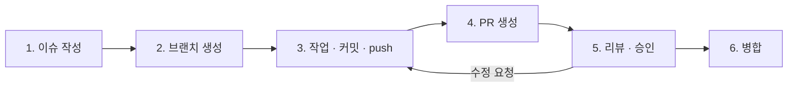

# 협업 규칙

이슈 작성부터 병합까지 모든 작업은 아래 6단계를 거쳐요. **각 단계의 실행(이슈 생성, 브랜치 생성, 커밋, push, PR 생성, 승인, 병합)은 사람이 직접 해요.** AI는 내용(이슈 본문, 코드, 커밋 메시지, PR 본문, 리뷰 의견)의 초안만 써요. AI를 쓰는 방법은 [ai-guidelines.md](ai-guidelines.md)에 있어요.

## 한눈에 보기



| 단계 | 하는 사람 | AI가 도울 수 있는 것 |
| --- | --- | --- |
| 1. 이슈 작성 | 작업자 | 이슈 템플릿에 맞춘 본문 초안 |
| 2. 브랜치 생성 | 작업자 | 규칙에 맞는 브랜치 이름 제안 |
| 3. 작업 · 커밋 · push | 작업자 | 코드 작성, 커밋 메시지 초안. **커밋과 push는 사람이** |
| 4. PR 생성 | 작업자 | PR 제목·본문 초안 |
| 5. 리뷰 · 승인 | 다른 팀원 1명 이상 | 리뷰어가 diff를 이해하는 데 참고. **의견 작성과 승인은 리뷰어가** |
| 6. 병합 | 작업자 (승인 후) | 없음 |

## 처음 한 번 할 일

```bash
git clone git@github.com:LGCNS-MiniProject-Group3/backend.git
cd backend
git config core.hooksPath .githooks
```

`core.hooksPath`를 설정하면 커밋과 push 때 아래 검사가 자동으로 돌아요.

| 훅 | 언제 | 검사 |
| --- | --- | --- |
| `pre-commit` | 커밋 직전 | 코드 모양(Spotless). 어긋나면 `./gradlew spotlessApply` 후 다시 커밋 |
| `commit-msg` | 커밋 직전 | 커밋 메시지 형식 |
| `pre-push` | push 직전 | `main` · `develop`으로 직접 push 차단, 브랜치 이름 형식 |

`--no-verify`로 훅을 건너뛰지 않아요.

## 1. 이슈 작성

작업을 시작하기 전에 이슈부터 만들어요. 이슈가 없는 PR은 받지 않아요.

| 템플릿 | 언제 |
| --- | --- |
| 작업 요청 | 기능 이전·추가, 설정 작업 |
| 버그 신고 | 동작이 잘못됐을 때 |
| 스펙 변경 | 내부 API, Kafka 메시지, DB 테이블, 외부 API, 헤더·오류 형식을 바꿀 때 |

- **제목**: `[서비스] 할 일`. 예) `[gateway] JWT 검사 필터와 X-User-* 헤더 전달`
- **담당자(Assignee)**: 작업할 사람 1명
- **라벨**: 서비스 라벨 1개 이상 + 타입 라벨 1개
- **마일스톤**: `V1` 또는 `V2`
- **크기**: 하루 안에 PR까지 갈 수 있는 크기로 나눠요. 넘으면 이슈를 쪼개요.
- **완료 기준**: 리뷰어가 확인할 수 있는 결과로 적어요. "구현 완료"처럼 쓰지 않아요.

### 스펙 변경 이슈

다른 담당자의 코드에 영향을 주는 변경이에요. 아래 순서를 지켜요.

1. 스펙 변경 이슈를 열고, 영향받는 담당자를 모두 체크해요.
2. 영향받는 담당자가 이슈에 동의 댓글을 달아요.
3. [design.md](design.md)를 고치는 PR(`docs` 타입)을 먼저 병합해요.
4. 그다음에 코드를 고치는 PR을 올려요.

## 2. 브랜치 생성

```bash
git switch develop
git pull origin develop
git switch -c feat/12-gateway-jwt-filter
```

### 이름 규칙

```
<타입>/<이슈번호>-<서비스>-<짧은-설명>
```

| 예 | 뜻 |
| --- | --- |
| `feat/12-gateway-jwt-filter` | 12번 이슈, Gateway JWT 필터 |
| `fix/31-content-guide-badge` | 31번 이슈, content 가이드 배지 버그 |
| `chore/3-infra-compose-kafka` | 3번 이슈, docker-compose에 Kafka 추가 |
| `docs/20-design-internal-api` | 20번 이슈, 설계 문서의 내부 API 수정 |

- 타입은 커밋 타입과 같아요.
- 서비스는 커밋 범위와 같아요.
- 설명은 영어 소문자, 숫자, `-`만 써요.
- 이슈 하나에 브랜치 하나예요.

### 브랜치 종류

| 브랜치 | 용도 | 누가 병합 |
| --- | --- | --- |
| `main` | 배포. 병합하면 CD가 EC2에 배포 | 7번 (배포 PR) |
| `develop` | 통합. 모든 작업 브랜치의 대상 (기본 브랜치) | 각 PR 작성자 |
| `<타입>/*` | 작업 | — |

## 3. 작업 · 커밋 · push

### 작업 중

- 담당 서비스 폴더 안에서만 고쳐요. 다른 서비스나 `common`을 고쳐야 하면 그 담당자와 먼저 이야기해요.
- 코드 규칙은 [code-convention.md](code-convention.md)를 따라요.
- `develop`이 바뀌면 자주 받아와요.

```bash
git fetch origin
git merge origin/develop
```

### 커밋 메시지

```
<타입>(<범위>): <제목>

<본문: 무엇을, 왜 (선택)>

Refs: #<이슈번호>
```

```
feat(gateway): JWT 검사 후 X-User-Id 헤더 전달

클라이언트가 보낸 X-User-* 헤더는 먼저 지운다.

Refs: #12
```

| 타입 | 언제 |
| --- | --- |
| `feat` | 기능 추가 |
| `fix` | 버그 수정 |
| `refactor` | 동작은 같고 구조만 바꿈. 모놀리스 코드를 옮기는 작업 포함 |
| `test` | 테스트 추가·수정 |
| `docs` | 문서 |
| `style` | 코드 모양만 바꿈 (포맷, import 정리) |
| `chore` | 빌드 설정, 의존성, docker-compose |
| `ci` | GitHub Actions workflow |

| 범위 | 대상 |
| --- | --- |
| `gateway` `discovery` `config` | 인프라 서버 |
| `user` `content` `collector` `guide` `bookmark` | 업무 서비스 |
| `common` | 공통 모듈 (헤더·오류·Feign) |
| `kafka` | Kafka 공통 설정·메시지 DTO |
| `infra` | docker-compose, DB 초기화 |
| `ci` | workflow 전체 |
| `docs` | `docs/` 문서 |

- 제목은 50자 안쪽, 명사형이나 "~한다"로 끝내고 마침표를 찍지 않아요.
- 커밋 하나에는 한 가지 일만 담아요. 리팩터링과 기능 추가를 섞지 않아요.
- 다른 사람의 코드가 깨지는 변경은 콜론 앞에 `!`를 붙여요. 예) `feat(content)!: guide-input 응답에 sections 필드 추가`
- 임시 저장은 `wip: ...`로 써도 돼요. Squash and merge로 PR 하나가 커밋 하나로 합쳐져요.

### push 전에 확인

```bash
./gradlew :<모듈>:check     # 테스트 + Spotless
git diff origin/develop      # 올릴 내용을 한 번 더 확인
git push -u origin feat/12-gateway-jwt-filter
```

- 실패하는 검사를 남긴 채 push하지 않아요.
- AI가 쓴 코드도 커밋하기 전에 사람이 diff를 직접 읽어요.

## 4. PR 생성

- **대상**: `develop` (배포 PR만 `main`)
- **제목**: 커밋 메시지 형식과 같아요. Squash and merge를 쓰니까 PR 제목이 `develop`에 남는 커밋 제목이 돼요.
- **본문**: 템플릿(`.github/pull_request_template.md`)을 채워요. 이슈는 `Closes #번호`로 연결해요.
- **리뷰어**: [roles.md](roles.md)의 "함께 맞출 사람"에서 최소 1명. 스펙 변경이면 영향받는 담당자 모두.
- **라벨 · 마일스톤**: 이슈와 같게 달아요.
- **크기**: 바뀐 줄이 400줄을 넘으면 나눌 수 있는지 먼저 봐요. 모놀리스 코드를 그대로 옮기는 PR은 예외지만, 옮기기(`refactor`)와 고치기(`feat`·`fix`)는 PR을 나눠요.
- 아직 리뷰받을 준비가 안 됐으면 Draft PR로 열어요.

### PR 본문 쓰는 법

원본 저장소(mini8-backend)의 PR 규칙을 이어 써요.

| 이렇게 | 이러지 말고 |
| --- | --- |
| 명사형으로 끝내요: `X-User-Id 헤더 전달 추가` | `추가했습니다` · `추가함` |
| 불릿 하나에 변경 한 덩어리 | 파일마다 한 줄씩 |
| 바꾼 것은 화살표로: `@AuthenticationPrincipal → @CurrentUserId 전환` | `A를 B로 바꿈` |
| 확인을 부탁할 곳은 `(확인 요망)` | 질문을 본문 곳곳에 흩어 놓기 |

이모지와 높임말은 쓰지 않아요. 서버 API를 바꿨으면 Swagger나 `curl` 응답을 붙여요.

## 5. 리뷰 · 승인

### 리뷰어

- PR이 열리면 **반나절 안에** 첫 리뷰를 달아요. 시연 전날(11-04)은 2시간 안에요.
- 아래 순서로 봐요.

| 순서 | 볼 것 |
| --- | --- |
| 1 | 이슈의 완료 기준을 채우나 |
| 2 | 서비스 경계: 다른 서비스 테이블을 읽거나, 다른 서비스 엔티티를 참조하지 않나 |
| 3 | 스펙: 내부 API·메시지·테이블이 [design.md](design.md)와 같나. 다르면 스펙 변경 이슈가 있나 |
| 4 | 인증: `X-User-Id`를 `common`의 도구로 읽나. 권한이 필요한 API가 열려 있지 않나 |
| 5 | 비밀 값: 키·비밀번호·토큰이 코드나 설정 파일에 없나 |
| 6 | 테스트: 바뀐 동작을 확인하는 테스트나 확인 방법이 있나 |
| 7 | 코드 규칙: [code-convention.md](code-convention.md) |

- 의견에는 머리말을 붙여서 꼭 고쳐야 하는지 알 수 있게 해요.

| 머리말 | 뜻 |
| --- | --- |
| `[필수]` | 고치기 전에는 승인하지 않아요 |
| `[제안]` | 고치면 좋지만 작성자가 판단해요 |
| `[질문]` | 이해가 안 되는 곳. 답을 듣고 판단해요 |

- `[필수]`가 없으면 **Approve**, 있으면 **Request changes**를 눌러요.
- AI로 diff를 요약하거나 문제를 찾아봐도 돼요. 다만 AI가 찾은 내용은 리뷰어가 직접 확인한 뒤 자기 말로 남겨요. 승인은 리뷰어가 코드를 읽고 판단한 결과여야 해요.

### 작성자

- 의견마다 답글을 달아요. 고쳤으면 고친 커밋을, 고치지 않으면 이유를 적어요.
- 대화를 resolve 하는 건 의견을 단 리뷰어예요.
- 고친 뒤에는 리뷰어에게 다시 요청(Re-request review)해요.

## 6. 병합

| PR | 병합 방식 | 조건 |
| --- | --- | --- |
| 작업 브랜치 → `develop` | **Squash and merge** | CI 통과, 승인 1명 이상, 모든 대화 resolve |
| `develop` → `main` (배포) | **Create a merge commit** | CI 통과, 승인 1명 이상, 통합 테스트 체크리스트 확인 |

- 병합은 승인을 받은 뒤 **PR 작성자**가 해요. 배포 PR은 7번이 해요.
- 병합한 뒤 브랜치는 자동으로 지워져요. 로컬 브랜치도 지워요.

```bash
git switch develop
git pull origin develop
git branch -d feat/12-gateway-jwt-filter
```

- 병합 후 문제가 생기면 GitHub의 **Revert** 버튼으로 되돌리는 PR을 만들어요. `develop`이나 `main`을 강제로 되돌리지(force push) 않아요.

## 충돌이 났을 때

혼자 지우지 않고, 그 파일을 고친 사람과 같이 봐요.

```bash
git fetch origin
git merge origin/develop
# 충돌 정리 후
git commit
```

rebase 후 force push는 내 작업 브랜치에서만, 리뷰가 시작되기 전에만 해요.

## 라벨과 마일스톤

| 종류 | 이름 |
| --- | --- |
| 서비스 | `svc:gateway` `svc:discovery` `svc:config` `svc:common` `svc:user` `svc:content` `svc:collector` `svc:guide` `svc:bookmark` `svc:kafka` `svc:infra` `svc:ci` |
| 타입 | `type:feat` `type:fix` `type:refactor` `type:chore` `type:docs` `type:test` |
| 상태 | `spec-change` (스펙 변경), `blocked` (다른 작업을 기다림) |
| 마일스톤 | `V1` (서비스 분리·Feign·Kafka 발행/수신·CI/CD), `V2` (모니터링·분산 추적·부하 테스트) |

## 저장소 설정 (1번·7번이 처음에 한 번)

규칙을 사람이 지키는 데만 맡기지 않고 GitHub 설정으로 막아요. 이 설정이 AI가 실수로 push하거나 병합하는 것도 막아 줘요.

- 기본 브랜치: `develop`
- 병합 방식: Squash merge와 Merge commit만 켜요. Rebase merge는 꺼요.
- 병합 후 브랜치 자동 삭제: 켜요.
- `main`, `develop` 브랜치 보호 규칙:
  - Require a pull request before merging
  - Require approvals: 1
  - Dismiss stale pull request approvals when new commits are pushed
  - Require conversation resolution before merging
  - Require status checks to pass: CI (ci.yml이 생기면)
  - Do not allow bypassing the above settings
  - Allow force pushes · Allow deletions: 끔
- 라벨과 마일스톤 `V1`, `V2`를 만들어요.

## 올리면 안 되는 것

- `.env`, `*.pem`: `.gitignore`가 막고 있어요. 강제로 올리지 않아요.
- API 키, 비밀번호, JWT 서명 키, 토큰을 코드나 `application*.yml`에 쓰지 않아요.
- 실수로 올렸으면 바로 팀에 알리고 키를 폐기·재발급해요. 커밋을 지워도 이미 노출된 키는 안전하지 않아요.
