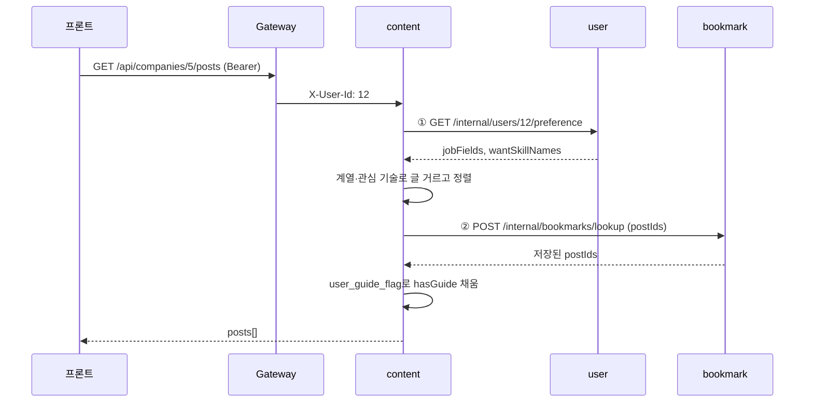
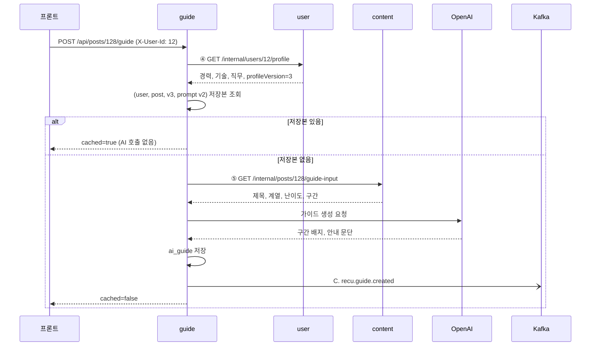
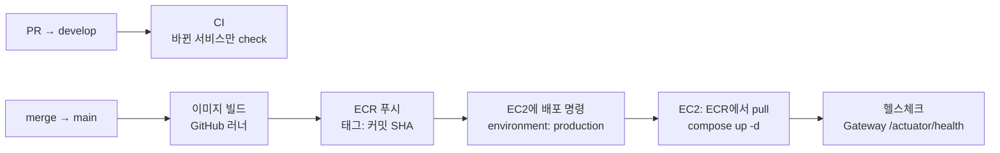

# ReCu MSA 전환 설계

1차 8조 프로젝트 ReCu(기술 블로그 읽기 안내 서비스)의 단일 Spring Boot 서버를 5개 마이크로서비스로 나누는 설계예요. 서비스 경계, 서비스 간 통신, DB 분리, 원본 코드에서 고칠 곳을 정리했어요.

| 항목 | 내용 |
| --- | --- |
| 원본 코드 | [mini8-backend](https://github.com/LGCNS-AM06-8/mini8-backend) (develop), [mini8-frontend](https://github.com/LGCNS-AM06-8/mini8-frontend). 원본을 다루는 법과 경로 표기는 [README.md](README.md#원본-코드) |
| 역할 분담 | [roles.md](roles.md) |
| 그림판 | 팀 Excalidraw (주소는 팀 채널). 그림과 이 문서가 다르면 **이 문서가 기준**이에요 |
| 원본 스펙 | [reference/api-spec.md](reference/api-spec.md) (외부 API), [reference/erd.md](reference/erd.md) (테이블) |
| 최종 수정 | 2026-10-30 |

> 스펙(내부 API, Kafka 메시지, DB 테이블)을 바꾸려면 "스펙 변경" 이슈를 먼저 열고, 이 문서를 고치는 PR을 코드보다 먼저 병합해요.

## 목차

1. [개요](#1-개요)
2. [서비스 구성](#2-서비스-구성)
3. [시스템 구성도](#3-시스템-구성도)
4. [인증과 Gateway](#4-인증과-gateway)
5. [동기 통신 (OpenFeign)](#5-동기-통신-openfeign)
6. [비동기 통신 (Kafka)](#6-비동기-통신-kafka)
7. [주요 흐름](#7-주요-흐름)
8. [DB 분리](#8-db-분리)
9. [공통 인프라](#9-공통-인프라)
10. [CI/CD 파이프라인](#10-cicd-파이프라인)
11. [리팩터링 목록](#11-리팩터링-목록)
12. [요구사항 대응](#12-요구사항-대응)
13. [결정 사항](#13-결정-사항)

---

## 1. 개요

### 원본 시스템

- React(Vercel) → Spring Boot 단일 서버(Railway) → MariaDB. 외부 연동은 Google OAuth, Gemini예요.
- Spring Boot 3.4.5, Java 17, JPA `ddl-auto`로 스키마 생성. 테이블 11개, API 17개.
- 코드가 `features/` 아래 기능별 패키지(`user`, `tech`, `company`, `post`, `guide`, `bookmark`, `collect`)로 나뉘어 있어 서비스 경계를 잡기 쉬워요.
- 엔티티는 `database/` 한 곳에 모여 있고, 다른 기능의 엔티티끼리 `@ManyToOne`으로 묶여 있어요. 분리 작업은 대부분 이 연결을 끊는 일이에요.

### 설계 원칙

- **프론트 API 경로는 바꾸지 않아요.** 프론트는 `VITE_API_BASE_URL` 하나만 Gateway 주소로 바꿔요.
- **다른 서비스의 테이블은 읽지 않아요.** 필요하면 Feign으로 묻거나, Kafka 메시지를 받아 자기 DB에 사본을 둬요.
- **다른 서비스의 행은 id 값으로만 참조해요.** 서비스 경계를 넘는 외래 키는 두지 않아요.
- **V1을 먼저 끝내요.** 서비스 분리·Feign·Kafka 발행/수신·CI/CD가 돌아간 뒤에 V2(Kafka 동기화 처리)를 붙여요.

### 범위

| 단계 | 하는 것 |
| --- | --- |
| **V1** | 서비스 5개 분리, OpenFeign 동기 통신, Kafka 비동기 통신(발행·수신), GitHub Actions CI/CD (ECR + EC2 + RDS, 필수 10번), Config 설정 암호화, Spring Cloud Bus |
| **V2** | Kafka 이벤트 동기화 처리: 재시도, DLT, 중복 무시(멱등성), 순서 뒤바뀜 처리 |
| 안 함 | Saga, outbox |

## 2. 서비스 구성

| 서비스 | 원본 패키지 | 소유 테이블 | 외부 API (Gateway 경로) |
| --- | --- | --- | --- |
| user | `user` | app_user, user_job_field, user_skill | `/api/auth/**`, `/api/profile` |
| content | `company`, `post`, `tech`, `collect`의 저장 부분 | company, blog_post, blog_post_section, blog_post_category, blog_post_tag, tech_tag, *user_guide_flag (사본)* | `/api/companies/**`, `/api/posts/{id}`, `/api/tech-tags` |
| collector | `collect`의 수집·분할·분류 부분 | collect_job (신규) | `/api/admin/collect/**` |
| guide | `guide` | ai_guide | `/api/posts/{id}/guide` |
| bookmark | `bookmark` | bookmark, *user_guide_flag (사본)* | `/api/bookmarks/**` |

공통 인프라로 gateway, discovery(Eureka), config가 붙고, 메시지 브로커로 Kafka를 써요.

> **Gateway 라우팅 주의.** `/api/posts/{id}`는 content로, `/api/posts/{id}/guide`는 guide로 가야 해요. guide 라우트를 먼저 선언하거나 `order`를 더 낮게 줘서 먼저 매칭되게 해요.

## 3. 시스템 구성도

실선은 동기 호출(HTTP, Feign), 점선은 Kafka 메시지예요.

```mermaid
flowchart LR
  FE[React 프론트] --> GW[API Gateway<br/>JWT 검증]
  GW --> U[user]
  GW --> C[content]
  GW --> CL[collector]
  GW --> G[guide]
  GW --> B[bookmark]

  C -- Feign --> U
  C -- Feign --> B
  CL -- Feign --> C
  U -- Feign --> C
  G -- Feign --> U
  G -- Feign --> C
  B -- Feign --> C

  CL -. post.collected .-> K((Kafka))
  U -. profile.updated .-> K
  G -. guide.created .-> K
  K -. post.collected .-> C
  K -. profile.updated / guide.created .-> C
  K -. profile.updated / guide.created .-> B

  U --- DU[(user DB)]
  C --- DC[(content DB)]
  CL --- DCL[(collector DB)]
  G --- DG[(guide DB)]
  B --- DB[(bookmark DB)]

  U --> GO[Google OAuth]
  G --> AI[OpenAI]
  CL --> AI
```

Eureka와 Config Server는 모든 서비스가 연결되므로 그림에서 뺐어요. 서비스는 Eureka에 등록하고, Feign과 Gateway는 서비스 이름(`lb://content`)으로 상대를 찾아요.

## 4. 인증과 Gateway

지금은 서버 안의 `JwtAuthenticationFilter`가 요청마다 토큰을 검증해요. 이 검증을 Gateway의 글로벌 필터로 옮겨요.

1. Gateway가 `Authorization: Bearer` 토큰을 검증해요. 서명 키는 Config Server에서 받아요.
2. 검증에 성공하면 토큰에서 꺼낸 값을 헤더로 붙여 넘겨요: `X-User-Id`, `X-User-Role`.
3. 클라이언트가 직접 보낸 `X-User-*` 헤더는 Gateway가 먼저 지워요. 지우지 않으면 누구나 다른 사용자로 위장할 수 있어요.
4. 각 서비스는 JWT를 다루지 않고 `X-User-Id` 헤더만 읽어요. 토큰 발급·재발급·로그아웃은 user 서비스가 그대로 맡아요.

### 로그인과 토큰 저장

원본 방식을 그대로 옮겨요.

- 로그인은 Google OAuth예요. 프론트가 받은 Google 토큰을 `POST /api/auth/google`로 보내면, user 서비스가 Google에 확인한 뒤 회원을 찾거나 만들고 Access·Refresh 토큰을 발급해요.
- Refresh 토큰은 user 서비스 DB의 `app_user.refresh_token`에 저장해요. 재발급(`/api/auth/refresh`)은 이 값과 비교하고, 로그아웃은 이 값을 지워요.
- Gateway는 Access 토큰의 서명과 만료만 검사해요. Refresh 토큰은 보지 않아요.
- Redis는 쓰지 않아요. 로그아웃한 Access 토큰은 만료될 때까지 유효해요(원본과 같음).

### 토큰 없이 통과시키는 경로

원본 `SecurityConfig`의 `permitAll` 목록을 그대로 옮겨요.

| 경로 | 비고 |
| --- | --- |
| `POST /api/auth/google`, `POST /api/auth/refresh` | `/api/auth/logout`은 토큰 필요 |
| `GET /api/tech-tags` | |
| `GET /api/companies/{id}` | 기업 목록 `GET /api/companies`는 토큰 필요 |
| `/swagger-ui/**`, `/v3/api-docs/**` | |
| ~~`POST /api/admin/collect/import`~~ | 원본에서 임시로 열어 둔 경로. 이번에 ADMIN 전용으로 닫아요 |

`/api/admin/**`는 Gateway에서 `X-User-Role`이 `ADMIN`인지 확인하고, 아니면 403 `FORBIDDEN`을 돌려줘요. 오류 응답 모양(`code`, `message`, `field`)은 원본 규격을 그대로 따라요.

서비스 간 내부 호출 경로(`/internal/**`)는 Gateway 라우트에 넣지 않아 외부에서 호출할 수 없게 해요.

## 5. 동기 통신 (OpenFeign)

응답에 바로 필요한 값만 Feign으로 물어요. 목록 화면에서 글마다 한 번씩 부르지 않도록, 여러 id를 한 번에 보내는 일괄 조회 형태로 만들어요. 번호(①~⑦)는 [roles.md](roles.md)와 같아요.

| # | 호출 | 내부 API | 쓰는 곳 | 대체하는 원본 코드 | 제공 담당 |
| --- | --- | --- | --- | --- | --- |
| ① | content → user | `GET /internal/users/{userId}/preference`<br>→ jobFields, wantSkillNames, profileVersion | 기업 목록 정렬, 기업의 글 목록 필터 | `CompanyPostQueryRepository`의 user_job_field, user_skill 조회 | 2번 |
| ② | content → bookmark | `POST /internal/bookmarks/lookup`<br>body: userId, postIds → 저장된 postIds | 글 목록·글 상세의 `bookmarked` | `findBookmarkedPostIds`, `PostRepository.countBookmarkByUserIdAndPostId` | 2번 |
| ③ | user → content | `GET /internal/tech-tags?ids=…`<br>→ id, name 목록 | 프로필 저장 때 기술 번호 검증, 프로필 응답의 기술 이름 | `ProfileService`의 `TechTagRepository` | 3번 |
| ④ | guide → user | `GET /internal/users/{userId}/profile`<br>→ 경력, 보유·관심 기술, 희망 직무, profileVersion | 가이드 재사용 키, AI 입력 | `GuideService`의 `profileService.getProfile` | 2번 |
| ⑤ | guide → content | `GET /internal/posts/{postId}/guide-input`<br>→ 제목, 계열, 난이도, 구간 목록 | AI 입력 | `GuideSectionRepository`, `BlogPostRepository` | 3번 |
| ⑥ | collector → content | `GET /internal/companies`<br>`GET /internal/posts/urls?companyId=`<br>→ 수집 대상 기업, 이미 저장된 글 url | 수집 대상 고르기, 기존 글을 걸러 AI 재분류 방지 | `PostIngestService`의 url 중복 확인 | 3번 |
| ⑦ | bookmark → content | `POST /internal/posts/summaries`<br>body: postIds → 카드 정보(제목, 기업, 계열, 요지, 기술, 발행일) | 저장한 글 목록, 저장 때 글 존재 확인(없으면 404) | `BookmarkService`의 `BlogPostRepository`, `findTags` | 3번 |

> **순환 호출 주의.** content와 user가 서로 불러요(① 선호 조회, ③ 기술 이름 조회). 한 요청 안에서 서로를 다시 부르는 경로는 없어서 문제는 없지만, 새 호출을 추가할 때 고리가 생기지 않는지 확인해요.

### 상대가 꺼져 있거나 느리면

기다리다 멈추지 않게 모든 Feign 호출에 타임아웃을 둬요(`common-web` 기본값). 넘거나 실패하면 값의 성격에 따라 다르게 답해요.

| 값의 성격 | 해당 | 응답 |
| --- | --- | --- |
| 꼭 필요한 값 | ① ③ ④ ⑤ ⑥ ⑦ | 502 `UPSTREAM_ERROR` ("잠시 후 다시 시도"). 원본 오류 규격 `{code, message, field}` 그대로 |
| 화면을 꾸미는 값 | ② 저장 표시 | fallback으로 `bookmarked=false`를 채우고 화면은 정상 응답 (3번 담당) |

## 6. 비동기 통신 (Kafka)

번호(A~C)는 [roles.md](roles.md)와 같아요.

| # | 토픽 | 발행 | 수신 | 키 | 수신 쪽이 하는 일 |
| --- | --- | --- | --- | --- | --- |
| A | `recu.post.collected` | collector | content | url | 수집·분류가 끝난 글 1편을 저장(글, 구간, 기술 태그, 분류어). `blog_post.url` UNIQUE라 이미 있으면 건너뜀 |
| B | `recu.profile.updated` | user | content, bookmark | userId | 그 사용자의 `user_guide_flag`를 모두 지움. 프로필이 바뀌면 기존 가이드는 더 이상 유효하지 않기 때문 |
| C | `recu.guide.created` | guide | content, bookmark | userId | `user_guide_flag`에 (userId, postId) 추가. 글 목록과 저장 목록의 `hasGuide` 값으로 씀 |

토픽 이름 규칙은 `recu.<무엇이>.<어떻게됐다>`(과거형)예요. 보낸 서비스는 답을 기다리지 않고 바로 자기 일을 해요.

### 왜 hasGuide를 메시지로 처리하나

원본은 글 목록을 만들 때 ai_guide 테이블을 JOIN해서 `hasGuide`를 구했어요. 분리 후 이걸 Feign으로 하면 목록 하나에 guide 서비스 호출이 추가되고, guide 서비스가 내려가면 목록 화면까지 실패해요. 대신 가이드가 만들어질 때 메시지로 알려 주고, content와 bookmark가 자기 DB에 작은 사본(`user_guide_flag`)을 두게 해요. 사본은 잠시 늦을 수 있지만, "가이드 있음" 표시가 몇 초 늦게 뜨는 정도라 허용할 수 있어요.

### 메시지 형식 (V1)

모든 메시지는 같은 봉투를 써요. 키는 순서가 중요한 단위로 잡아요(글은 url, 사용자 메시지는 userId). DTO는 `common`의 Kafka 모듈에 6번이 만들고, 모두 그것만 써요.

```jsonc
// 공통 봉투
{
  "eventId": "6f1c2a1e-…",          // UUID. V2에서 중복 확인에 씀
  "eventType": "GUIDE_CREATED",
  "occurredAt": "2026-11-03T14:04:00+09:00",
  "payload": { … }
}

// A. recu.post.collected   key = url
{ "companyId": 5, "url": "https://oliveyoung.tech/…", "externalId": null,
  "title": "…", "publishedAt": "2026-03-18T00:00:00+09:00",
  "contentHtml": "…", "contentText": "…", "hasCode": true,
  "isTech": true, "field": "Backend", "level": "중급", "summary": "…",
  "categories": ["Backend"],
  "tags": [{ "name": "Kafka", "rank": 1 }, { "name": "Redis", "rank": 2 }],
  "sections": [{ "seq": 1, "heading": "…", "level": "h2", "contentText": "…" }] }

// B. recu.profile.updated  key = userId
{ "userId": 12 }

// C. recu.guide.created    key = userId
{ "userId": 12, "postId": 128 }
```

- `eventType`은 토픽마다 하나예요. A `POST_COLLECTED`, B `PROFILE_UPDATED`, C `GUIDE_CREATED`. 토픽 이름의 뒤 두 단어를 UPPER_SNAKE_CASE로 옮겨요.
- B·C의 payload는 위 V1 기본값으로 확정했어요.
- `eventId`는 V1에서 담기만 하고, V2에서 중복 확인에 써요.
- V2에서 순서 뒤바뀜을 처리할 때 B·C에 `profileVersion`을 더해요(아래 V2 표).

> **메시지 크기.** A에는 본문 HTML과 텍스트가 함께 들어가요. 기술 글 평균은 9,569자지만 가장 긴 글은 56,200자라, HTML까지 합치면 1MB 기본 한도에 가까워질 수 있어요. 브로커·프로듀서의 `max.message.bytes` / `max.request.size`를 2~4MB로 올리거나, 압축(`compression.type=lz4`)을 켜요.

### V2: 동기화 처리

V1이 끝난 뒤에 붙여요. 수신 쪽 오류 처리는 `common`의 Kafka 설정 한 곳에 넣어서, 서비스 코드는 거의 고치지 않게 해요.

| 항목 | 내용 |
| --- | --- |
| 재시도 | `DefaultErrorHandler`로 3회 재시도(1초, 2초, 4초) |
| DLT | 재시도 후에도 실패하면 `<토픽>.DLT`로 보냄. 역직렬화 실패는 재시도 없이 바로 DLT |
| 중복 무시 | A는 `blog_post.url` UNIQUE, C는 `user_guide_flag` (userId, postId) PK로 같은 메시지를 두 번 받아도 결과가 같음 |
| 순서 뒤바뀜 | B·C 메시지와 `user_guide_flag`에 `profileVersion`(`profile_version`)을 더하고, 저장된 최신 버전보다 작은 메시지는 무시 |
| 프로듀서 | `enable.idempotence=true`(Kafka 3.x 클라이언트 기본값), `acks=all`, 발행 실패 시 재시도와 로그 |
| 시연 | kafka-ui 컨테이너를 Compose에 추가해 메시지 흐름을 화면으로 보여 줌 |

#### outbox 없이 가는 이유와 한계

팀 회의(2026-10-31)에서 outbox 없이 구현하기로 했어요. 안내 자료의 Kafka 이벤트 동기화 기준은 "실패 시 재시도, 중복 이벤트 무시(멱등성) 검증"이라 outbox가 필수가 아니에요.

- **발행 방식:** DB 트랜잭션이 커밋된 뒤에 발행해요(`AFTER_COMMIT`). 저장이 롤백됐는데 메시지만 나가는 일은 없어요.
- **남는 한계:** 커밋은 됐는데 발행이 실패하면(브로커 장애 등) 그 메시지는 사라질 수 있어요. 프로듀서 재시도로 대부분 막지만 완전히 보장하지는 않아요.
- **잃어도 되는 이유:** A는 수집을 다시 돌리면 같은 글을 다시 보내고 url UNIQUE로 중복 없이 채워져요. B·C를 잃으면 "가이드 있음" 표시가 틀릴 수 있지만, 다음 가이드 생성이나 프로필 수정 때 다시 맞춰져요. 돈이나 재고처럼 틀리면 안 되는 데이터가 아니에요.
- **결과보고서:** 이 판단과 한계를 함께 적어요. outbox는 "발행 유실까지 막아야 할 때의 다음 단계"로 남겨요.

#### 증빙 시나리오

| 검증 | 시나리오 | 기대 결과 |
| --- | --- | --- |
| 재시도 | content DB를 잠시 멈춘 상태에서 수집을 실행하고, 재시도 간격 안에 DB를 다시 켬 | 로그에 재시도가 찍히고, DB가 돌아온 뒤 글이 저장됨. 유실 없음 |
| DLT | 형식이 틀린 A 메시지를 직접 발행 | 재시도 없이 `recu.post.collected.DLT`로 이동. 정상 메시지 처리는 멈추지 않음 |
| 멱등성 (글) | 같은 기업을 두 번 수집하거나, 같은 메시지를 두 번 발행 | `blog_post` 행 수가 늘지 않음 |
| 멱등성 (가이드) | 같은 C 메시지를 두 번 발행 | `user_guide_flag`에 한 행만 있음 |
| 순서 뒤바뀜 | profileVersion 3의 B를 처리한 뒤, version 2의 C를 늦게 발행 | 늦게 온 메시지를 무시해 `hasGuide`가 잘못 켜지지 않음 |
| 동기화 확인 | 가이드를 만든 직후 기업의 글 목록과 저장한 글 목록을 조회 | 두 화면 모두 `hasGuide=true`. 프로필을 수정하면 두 화면 모두 false로 바뀜 |

## 7. 주요 흐름

### 기업의 글 목록 `GET /api/companies/{id}/posts`

서비스 간 연결이 가장 많은 API예요. 원본은 쿼리 한 번이었지만, 분리 후에는 아래처럼 돼요.



### AI 읽기 가이드 `POST /api/posts/{id}/guide`



### 글 수집 `POST /api/admin/collect`

1. collector가 요청을 받고 `collect_job`에 RUNNING으로 기록한 뒤 202와 `jobId`를 바로 돌려줘요(원본과 같음). 이미 도는 작업이 있으면 새로 시작하지 않고 그 작업의 `jobId`를 돌려줘요.
2. 백그라운드에서 기업별로 RSS·사이트맵·API를 읽고, 구간을 나누고, OpenAI로 분류해요.
3. 이미 저장된 글을 다시 분류하지 않도록, 시작할 때 content에 기존 url 목록을 물어 걸러 내요(⑥).
4. 글 1편이 끝날 때마다 A `recu.post.collected`를 발행해요. content가 받아서 저장해요.
5. 파일 적재(`/api/admin/collect/import`)도 같은 메시지로 발행해요.
6. 끝나면 `collect_job`을 DONE(일부 기업 실패 포함)이나 FAILED(작업 전체 중단)로 바꾸고, 발행한 글 수를 남겨요.

### 수집 작업 조회 (신규 외부 API)

원본은 작업 상태를 메모리에만 두고 조회 API가 없었어요. `collect_job`으로 옮기면서 관리자가 진행 상황을 볼 수 있게 조회 API 2개를 더해요. 원본 외부 API 17개에 더해지는 **유일한 신규 외부 API**예요.

| API | 응답 | 오류 |
| --- | --- | --- |
| `GET /api/admin/collect/jobs/{jobId}` | `{ jobId, companyId, status, startedAt, finishedAt, newPostCount }` | 404 `NOT_FOUND` (없는 jobId) |
| `GET /api/admin/collect/jobs` | 최근 작업 목록(최신순, 최대 20개), 항목 모양은 위와 같음 | — |

- 둘 다 `/api/admin/**`라 Gateway가 ADMIN만 통과시켜요(401·403).
- `status`: `RUNNING` · `DONE` · `FAILED`. `companyId`가 `null`이면 전체 수집이에요.
- `newPostCount`는 collector가 **메시지로 보낸** 글 수예요. content 저장은 비동기라, DONE 직후 기업 글 목록에 바로 다 보이지 않을 수 있어요.
- 담당은 5번이고, 응답 필드 이름은 이 표가 기준이에요.

## 8. DB 분리

MariaDB 서버 하나에 서비스별 데이터베이스(스키마) 5개를 만들고, 서비스마다 다른 계정을 줘요. 각 계정은 자기 DB에만 권한이 있어서 다른 서비스 테이블을 읽을 수 없어요. "서비스별 DB 분리" 요구사항은 이 방식(논리적 분리 + 계정 권한 분리)으로 증빙해요.

| 환경 | MariaDB 서버 | 비고 |
| --- | --- | --- |
| local · dev | compose의 MariaDB 컨테이너 1개 | 처음 뜰 때 `infra/db/`의 SQL로 DB 5개·계정 5개·테이블 생성, 덤프 적재 |
| prod | **AWS RDS for MariaDB 인스턴스 1대** | 같은 SQL을 처음 한 번 실행. EC2에는 DB 컨테이너를 두지 않음 |

테이블은 `infra/db/`의 SQL로 만들고, 서비스는 `ddl-auto: validate`로 확인만 해요. 서비스 계정에는 데이터 권한만 줘요. 파일 구성은 [code-convention.md](code-convention.md#테이블-생성-sql)에 있어요.

> **RDS를 5대로 나누지 않는 이유.** 물리적으로 나누면 비용·보안 그룹·백업 관리가 5배가 되는데, 6일 프로젝트에서 얻는 이점이 작아요. 서비스는 자기 DB 이름과 계정만 알기 때문에, 나중에 RDS를 나눠도 서비스 코드는 바뀌지 않고 접속 주소만 바뀌어요. 결과보고서에는 이 판단 근거를 적어요.

| 스키마 | 테이블 | 다른 서비스 참조 (값만 보관) | 담당 |
| --- | --- | --- | --- |
| `recu_user` | app_user, user_job_field, user_skill | `user_skill.tech_tag_id` → content | 2번 |
| `recu_content` | company, blog_post, blog_post_section, blog_post_category, blog_post_tag, tech_tag, user_guide_flag | `user_guide_flag.user_id` → user | 3·4번 |
| `recu_collector` | collect_job | `collect_job.company_id` → content | 5번 |
| `recu_guide` | ai_guide | `user_id` → user, `blog_post_id` → content | 6번 |
| `recu_bookmark` | bookmark, user_guide_flag | `user_id` → user, `blog_post_id` → content | 2·4번 |

### 새 테이블

```sql
-- content, bookmark 각각에 둔다 (B·C 메시지의 사본). "가이드 있음" 표시 — (사용자, 글)마다 1줄
user_guide_flag (
  user_id          BIGINT NOT NULL,   -- user 서비스의 회원 번호
  blog_post_id     BIGINT NOT NULL,   -- content 서비스의 글 번호
  PRIMARY KEY (user_id, blog_post_id)
)
-- V2: 순서 뒤바뀜 처리를 위해 profile_version INT NOT NULL 칸을 더한다

-- collector: 수집 작업 1번 = 1줄 (원본은 메모리에만 있었음)
collect_job (
  job_id          VARCHAR(40) PRIMARY KEY,  -- collect-날짜시각
  company_id      BIGINT NULL,              -- content의 기업 번호. NULL = 전체 수집
  status          VARCHAR(20) NOT NULL,     -- RUNNING | DONE | FAILED
  started_at      DATETIME NOT NULL,
  finished_at     DATETIME NULL,
  new_post_count  INT NOT NULL DEFAULT 0    -- 새로 메시지로 보낸 글 수
)
```

### 초기 데이터

원본 저장소 루트의 `mini8-content-dump.sql`(기업, 글, 구간, 기술 표. 사용자 정보 없음)을 이 저장소의 `infra/db/`로 가져와서(5번), 로컬은 컨테이너가 처음 뜰 때, RDS는 처음 만들 때 한 번 `recu_content`에 넣어요. user, guide, bookmark는 빈 상태로 시작해요. 덤프의 테이블 정의는 `02-content-schema.sql`로 옮기고, 덤프에서는 데이터(INSERT)만 써요. content 엔티티와 덤프 컬럼이 맞는지는 `validate`가 첫 기동 때 확인해 줘요.

## 9. 공통 인프라

### 버전

- Spring Boot **3.4.5** (원본 유지), Java 17
- Spring Cloud **2024.0.x**: Boot 3.4와 짝이 맞는 릴리스 트레인. Eureka, Gateway, Config, OpenFeign을 이걸로 맞춰요.

### 포트 (로컬 · Docker Compose)

| 구성 요소 | 포트 | 비고 |
| --- | --- | --- |
| gateway | `8000` | 원본 서버와 같은 포트. 프론트 로컬 설정을 바꾸지 않아도 됨 |
| discovery (Eureka) | `8761` | 대시보드 |
| config | `8888` | |
| user / content / collector / guide / bookmark | `8081` ~ `8085` | 순서대로 |
| MariaDB / Kafka | `3306` / `9092` | MariaDB는 local·dev만 컨테이너(prod는 RDS). Kafka는 KRaft 모드 단일 브로커 |

### 공통 모듈

| 모듈 | 내용 | 담당 |
| --- | --- | --- |
| `common/common-web` | `X-User-Id` 헤더 리졸버, 오류 응답 `{code, message, field}`·예외 처리기, Feign 타임아웃 설정 | 1번 |
| `common/common-kafka` | 토픽 이름 상수, 메시지 봉투·DTO 3개, 발행(`KafkaTemplate`)·수신(`@KafkaListener`) 설정 | 6번 |

### Config 설정 저장소

설정 파일은 이 저장소(공개)가 아니라 **별도 private GitHub 저장소**(`LGCNS-MiniProject-Group3/config`)에 둬요. Config Server가 이 저장소를 읽어 각 서비스에 설정을 내려줘요. 읽기 권한은 1번이 팀원에게 줘요.

- 서비스는 `CONFIG_URL`(기본 `http://localhost:8888`)의 Config Server에서 `<서비스 이름>`과 `SPRING_PROFILES_ACTIVE` 프로필에 맞는 설정을 받아요.
- Config Server가 꺼져 있으면 서비스가 뜨지 않아요(`fail-fast`). 그래서 Config Server를 가장 먼저 띄워요.

```
(private 설정 저장소)/
├─ application.yml              # 공통: Eureka 주소, Kafka 주소, 로그 형식
├─ application-local.yml        # local: IDE에서 서비스 실행, 인프라만 compose
├─ application-dev.yml          # dev: compose로 전체 스택 실행
├─ application-prod.yml         # prod: EC2 배포
├─ gateway.yml                  # JWT 서명 키, CORS 출처 (라우트·permitAll 목록은 gateway 코드)
├─ user.yml                     # DB, Google client id
├─ content.yml
├─ collector.yml                # 분류 모델 설정
├─ guide.yml                    # 가이드 모델, 가이드 지시문 버전
└─ bookmark.yml
```

### AI 호출 설정

가이드 생성(guide)과 글 분류(collector)는 원본의 Gemini 대신 OpenAI를 불러요. 두 서비스가 같은 방식으로 불러요.

| 항목 | 값 |
| --- | --- |
| 호출 | `POST https://api.openai.com/v1/chat/completions`, `Authorization: Bearer <키>` |
| 응답 형식 | `response_format: {"type": "json_object"}`. 원본 Gemini의 `responseMimeType: application/json`과 같은 역할이라, 지시문에 "JSON"이라는 말이 들어 있어야 해요 |
| 모델 | `gpt-4o-mini` |
| 실패 | 실패·시간 초과·형식 오류는 원본처럼 502 `AI_UNAVAILABLE`. 재시도는 429·5xx일 때 |

| 설정 키 | 파일 | 값 |
| --- | --- | --- |
| `openai.api-key` | 각 서비스의 application.yml | `${OPENAI_API_KEY:}`. 키는 설정 저장소에도 두지 않고 실행 환경의 `.env`로만 받아요(아래 비밀 값) |
| `collect.classify.model` | collector.yml | `gpt-4o-mini` |
| `guide.model` | guide.yml | `gpt-4o-mini`. 원본은 guide도 collector의 `collect.classify.model`을 읽었는데, 이번에 나눠요 |
| `guide.prompt-version` | guide.yml | `v2`. 원본의 `gemini.prompt-version`(`v1`)에서 이름을 바꾸고 올려요. 모델이 바뀌어 옛 가이드를 다시 쓰지 않게 해요 |

- 원본 글 402편은 Gemini로 분류된 결과를 그대로 써요. 새로 수집하는 글만 OpenAI로 분류해요.
- `gemini.*` 키는 코드가 바뀐 뒤에 설정 저장소에서 지워요. 먼저 지우면 옛 코드가 뜨지 않아요.

### 비밀 값

| 값 | 둘 곳 |
| --- | --- |
| DB 비밀번호, JWT 서명 키, Google client id | 설정 저장소에 `{cipher}`로 암호화해서 저장 (선택 2번) |
| `ENCRYPT_KEY`(복호화 키), 설정 저장소 읽기 토큰 | 실행 환경의 `.env`에만 (로컬은 각자, 배포는 EC2) |
| OpenAI 키 (`OPENAI_API_KEY`) | 실행 환경의 `.env`에만. 키 제공 조건이 "GitHub에 올리지 않음"이라 암호화해도 설정 저장소에 두지 않아요. 비어 있으면 서비스는 뜨고 AI 호출만 실패해요 |
| MariaDB root 비밀번호 (local·dev) | 각자 `.env` (DB 컨테이너가 Config Server보다 먼저 떠요) |
| RDS 마스터 비밀번호 (prod) | EC2에 두지 않음. DB·계정을 처음 만들 때만 쓰고, 담당자(7번)가 비공개로 보관 |

- 서비스는 비밀 값을 직접 갖지 않고, Config Server가 풀어서 내려준 값을 받아요.
- 각 담당이 필요한 비밀 값(Google client id 등)은 직접 넣지 않고 1번에게 전달해 암호화해서 넣어요.
- `ENCRYPT_KEY`와 저장소 토큰은 팀 채널 같은 비공개 경로로만 주고받아요. 1번이 팀원(로컬 실행)과 7번(EC2 `.env`, GitHub Secrets)에게 전달해요. 이슈·PR·커밋·공개 문서에는 적지 않아요.
- OpenAI 키도 같은 비공개 경로로 주고받아요. 배포에서는 EC2 `.env`에만 두고 GitHub Secrets에는 넣지 않아요. CI 테스트는 가짜 서버를 써서 키가 필요 없어요.
- `ENCRYPT_KEY`는 한 번 정하면 바꾸지 않아요. 바꾸면 설정 저장소의 `{cipher}` 값을 모두 다시 암호화해야 해요. 키가 새어 나가면 1번이 새 키로 다시 암호화하고 팀에 새 키를 전달해요.
- 설정을 고친 뒤에는 Spring Cloud Bus로 한 번에 반영해요(아래).

### 설정 일괄 갱신 (Spring Cloud Bus, 선택 1번)

설정 저장소를 고친 뒤 서비스를 하나씩 재시작하지 않고 한 번에 반영해요. 메시지 통로는 이미 있는 Kafka를 써요.

1. 설정 저장소에 변경을 push해요.
2. Config Server의 `POST /actuator/busrefresh`를 불러요.
3. Config Server가 Kafka의 Bus 토픽(`springCloudBus`)으로 갱신 신호를 보내고, 연결된 서비스가 설정을 다시 받아요.

- Config Server와 각 서비스에 `spring-cloud-starter-bus-kafka`를 넣어요 (1번이 `common-web`·config 모듈에 포함). gateway는 WebFlux라 common-web을 쓰지 않아서 gateway 모듈에 따로 넣어요.
- Kafka 주소: 서비스는 설정 저장소의 `spring.kafka.bootstrap-servers`를 써요. Config Server는 설정 저장소를 읽지 않아서 `KAFKA_BOOTSTRAP_SERVERS` 실행 환경 변수(기본 `localhost:9092`)로 받아요.
- 바뀐 값을 바로 다시 읽어야 하는 빈에는 `@RefreshScope`를 달아요. 시연 값은 Gateway의 CORS 허용 출처(`app.cors-origins`)예요. 갱신 전에는 새 출처의 사전 요청이 403, 갱신 후에는 200이에요. 다른 서비스는 갱신 신호를 받으면 로그에 바뀐 키 이름(`Keys refreshed [...]`)을 남겨요.
- `@ConfigurationProperties`로 받는 값은 `@RefreshScope` 없이도 갱신 때 다시 묶여요. `@Value`로 받아 빈을 만들 때 쓰는 값에만 `@RefreshScope`가 필요해요.
- `busrefresh` 엔드포인트는 Gateway에 연결하지 않아요. 운영자만 내부에서 불러요. 로컬은 `curl -X POST localhost:8888/actuator/busrefresh`, EC2는 8888을 외부에 열지 않으니 EC2 안에서 같은 명령을 실행해요.
- 테스트에서는 Bus를 꺼요(`spring.cloud.bus.enabled: false`, 각 서비스의 `src/test/resources/config/application.yml`). 켜 두면 없는 Kafka에 계속 접속을 시도해서 테스트가 몇 분씩 느려져요.
- Bus 토픽은 업무 토픽(`recu.*`)과 별개예요. 업무 메시지 규칙(6장)을 적용하지 않아요.

### 기동 순서 (Compose `depends_on`)

config → discovery → MariaDB(local·dev), Kafka → 각 서비스 → gateway. prod는 RDS가 항상 떠 있어요. 각 서비스는 Config Server의 healthcheck가 통과한 뒤 뜨도록 `condition: service_healthy`를 걸어요.

## 10. CI/CD 파이프라인

구현 기준은 "GitHub Actions로 빌드·테스트·이미지 푸시·배포를 자동화하고, 자동 배포를 1회 이상 시연하고, 배포 이력을 캡처"예요. 원본 저장소에는 workflow가 없어서 새로 만들어요(7번 담당).



### workflow 구성

| workflow | 언제 | 하는 일 |
| --- | --- | --- |
| `ci.yml` | develop·main 대상 PR | 바뀐 서비스 폴더만 골라 `./gradlew :<모듈>:check`(테스트 포함). PR 병합 조건(required check)으로 걸어 둠 |
| `cd.yml` | main에 push | 바뀐 서비스의 Docker 이미지를 빌드해 ECR에 푸시하고, EC2가 새 이미지를 받아 다시 띄우게 함. 배포 후 헬스체크가 실패하면 workflow를 실패로 표시 |

- **바뀐 서비스만 빌드**: `dorny/paths-filter`로 바뀐 폴더를 찾고 그 목록을 matrix로 돌려요. `common`이 바뀌면 전체를 빌드해요. 서비스 8개를 매번 다 빌드하면 한 번에 10분 넘게 걸려요.
- **이미지 태그**: `<계정ID>.dkr.ecr.ap-northeast-2.amazonaws.com/recu-<서비스>:<커밋 SHA>`와 `latest`. SHA 태그가 있어야 어떤 커밋이 배포됐는지 추적하고, 문제가 생기면 이전 SHA로 되돌릴 수 있어요.
- **비밀 값**: 서비스용 비밀 값은 설정 저장소에 암호화해 둬요(9장). EC2 `.env`에는 `ENCRYPT_KEY`와 설정 저장소 토큰만 둬요(DB는 RDS). AWS 접근 키는 OIDC를 쓰면 저장하지 않아도 돼요.
- **배포 이력**: 배포 job에 `environment: production`을 지정하면 저장소의 Deployments 화면에 배포 시각, 커밋, 결과가 자동으로 쌓여요. 이 화면과 Actions 실행 기록을 캡처해 증빙해요.

### 배포 대상: AWS ECR + EC2

이미지는 GitHub 러너에서 빌드해 ECR에 올리고, EC2는 빌드하지 않고 ECR에서 받아서 실행만 해요. EC2에서 빌드하면 Gradle 빌드 8개가 서비스 실행과 메모리를 다투고, 배포 시간도 길어져요.

| 구성 요소 | 설정 |
| --- | --- |
| ECR | 서비스마다 저장소 1개(`recu-gateway`, `recu-discovery`, `recu-user` …, 총 8개). 수명 주기 정책으로 최근 이미지 10개만 남겨 저장 비용을 막음 |
| GitHub → AWS 인증 | OIDC로 IAM 역할을 맡음(`aws-actions/configure-aws-credentials`). 역할에는 ECR 푸시 권한과 배포 명령 권한만 줌 |
| EC2 → ECR 인증 | 인스턴스에 `AmazonEC2ContainerRegistryReadOnly` 정책을 가진 IAM 역할을 붙임. EC2 안에서 `aws ecr get-login-password`로 로그인 |
| EC2에서 실행 | 이 저장소의 `infra/compose.prod.yaml`(파일 이름은 7번 확정)을 EC2에 복사하고, `.env`는 EC2에서만 만듦. 배포 명령은 `IMAGE_TAG=<SHA> docker compose pull && docker compose up -d`. 바뀐 서비스만 새 컨테이너로 바뀜 |
| RDS | MariaDB 인스턴스 1대(소형, 단일 AZ). DB 5개, 서비스별 계정, 테이블은 `infra/db/`의 SQL로 처음 한 번 생성. 서비스 접속 주소·계정은 설정 저장소의 prod 프로필에 `{cipher}`로 저장. 교육용 계정의 프리 티어 적용 여부는 계정 받은 뒤 확인 |
| 인스턴스 크기 | 메모리 8GB 이상(t3.large 급). JVM 8개 + Kafka라 4GB로는 부족(DB는 RDS라 EC2에서 빠짐). 서비스마다 `-Xmx256m`~`384m`로 상한을 둠. 프리 티어를 넘으므로 시연이 끝나면 인스턴스를 중지 |
| 보안 그룹 | EC2는 외부에 Gateway 포트만 엶. Eureka(8761), Kafka(9092)는 열지 않음. RDS(3306)는 EC2 보안 그룹에서 오는 연결만 허용 |

### 러너에서 EC2로 배포 명령 보내기

| 방식 | 장점 | 단점 |
| --- | --- | --- |
| **SSM Run Command** (권장) | 22번 포트를 열지 않아도 됨. SSH 키를 저장하지 않음. 실행 기록이 AWS 콘솔에 남음 | EC2에 SSM 에이전트와 `AmazonSSMManagedInstanceCore` 정책이 필요(Amazon Linux는 에이전트 기본 설치) |
| SSH (`appleboy/ssh-action`) | 설정이 가장 익숙하고 단순 | GitHub 러너 IP가 매번 달라 22번 포트를 넓게 열어야 함. 개인 키를 Secrets에 저장 |

> **제안:** AWS 계정을 받으면 바로, 빈 서비스라도 ECR 푸시부터 EC2 기동까지 파이프라인을 한 번 끝까지 통과시켜 둬요. 이후 기능이 붙을 때마다 자동 배포 이력이 쌓이고, 선택 4번(클라우드 실배포)도 함께 채워져요.

## 11. 리팩터링 목록

원본 코드에서 고쳐야 하는 곳이에요. 경로는 원본 저장소의 `src/main/java/com/mini8/backend/` 기준이에요. 옮긴 뒤에는 이 저장소의 `<모듈>/src/main/java/com/recu/<모듈>/` 아래에 둬요([code-convention.md](code-convention.md#패키지-구조)).

### 엔티티 연결 끊기

- [ ] `BookmarkEntity`: `@ManyToOne UserEntity`, `@ManyToOne BlogPostEntity` → `Long userId`, `Long blogPostId`
- [ ] `AiGuideEntity`: 위와 같음
- [ ] `UserSkillEntity`: `@MapsId("techTagId") @ManyToOne TechTagEntity` → `Long techTagId`. 복합키 `UserSkillPk`는 유지

### 다른 서비스 테이블을 읽는 쿼리 바꾸기

- [ ] `features/company/repository/CompanyPostQueryRepository`: user_job_field·user_skill 조회 → ①, bookmark 조회 → ②, ai_guide 조회 → `user_guide_flag`
- [ ] `features/post/repository/PostRepository.countBookmarkByUserIdAndPostId` → ②
- [ ] `features/bookmark/service/BookmarkService`: `UserRepository`(profileVersion), `BlogPostRepository`, `CompanyPostQueryRepository` → ⑦과 `user_guide_flag`
- [ ] `features/guide/service/GuideService`: `ProfileService`, `UserRepository`, `BlogPostRepository`, `GuideSectionRepository` → ④⑤
- [ ] `features/user/service/ProfileService`: `TechTagRepository` → ③

### 수집 파이프라인 나누기

- [ ] collector에 남길 것: `WebCollectService`, 각종 Reader, `SectionSplitter`, `PostClassifier`, `CollectJobService`
- [ ] content로 옮길 것: `PostIngestService`의 저장 부분 → A 수신 핸들러
- [ ] `CollectJobService`의 메모리 작업 상태 → `collect_job` 테이블
- [ ] 파일 적재(`/import`)는 `PostImportService`가 파일을 읽어 A를 발행하도록 바꿈

### 인증

- [ ] `JwtProvider` 검증 부분 → Gateway 필터. 발급 부분은 user 서비스에 남김
- [ ] 각 서비스의 `SecurityConfig`, `JwtAuthenticationFilter` 제거, `X-User-Id` 헤더 리졸버로 대체

### 공통 코드

- [ ] `commons/exception`(`ErrorCode`, `BusinessException`)과 `GlobalExceptionHandler` → `common` 모듈
- [ ] (선택) AI 호출 재시도(guide·collector의 OpenAI 호출에 있는 `Thread::sleep` 직접 구현) → Resilience4j Retry

## 12. 요구사항 대응

평가 배점: 필수 10개 × 7점, 선택 10개 × 3점(3개 이상 권장). **필수 10번만** 일부 구현해도 시도 과정을 증빙하면 부분 점수(1~7점)를 받아요.

### 버전 정책

| 버전 | 범위 | 시작 조건 |
| --- | --- | --- |
| **V1** | 필수 1~10번 + 선택 요구사항(V1 표시) | 바로 시작 |
| **V2** | Kafka 이벤트 동기화 (선택 10번) | V1 통합 테스트 체크리스트가 모두 통과한 뒤 |

### 필수 요구사항

| No | 요구사항 | 공통 기준 (안내 자료) | 채우는 방법 | 확인 방법 | 단계 |
| --- | --- | --- | --- | --- | --- |
| 1 | 마이크로서비스 분리 | 3~4개 이상, 서비스별 책임 정의 | 5개 서비스 (2장) | 서비스 5개가 각각 독립 기동 | V1 |
| 2 | Service Discovery | Eureka에 전 서비스 등록, 대시보드 확인 | discovery 모듈에 전 서비스와 gateway 등록 | Eureka 대시보드에서 전부 UP | V1 |
| 3 | API Gateway | 단일 진입점, 경로 라우팅, 공통 필터(로깅·인증 헤더 검증) | 경로 라우팅, 요청 로그 필터, JWT 검증 필터, `X-User-*` 위장 차단 (4장) | Gateway 경유 호출, 401·403 확인 | V1 |
| 4 | Config 중앙화 | Config Server로 공통·개별 설정 외부화, local/dev/prod 프로필 분리 | private 설정 저장소 + Config Server, local/dev/prod 프로필 (9장) | 서비스가 Config에서 DB·공통 설정을 받아 기동 | V1 |
| 5 | 동기 통신 | 즉시 응답이 필요한 조회를 OpenFeign으로 | 내부 API 7개 ①~⑦ (5장) | 기업 목록·가이드·북마크 화면 동작 | V1 |
| 6 | 비동기 통신 | Kafka 발행·구독으로 다른 서비스 데이터에 반영 | 토픽 3개 A~C (6장) | 수집·프로필 변경·가이드 생성 후 화면 반영 | V1 |
| 7 | 도메인 API | 핵심 도메인 CRUD와 상태 관리 | 원본 외부 API 17개 유지 ([reference/api-spec.md](reference/api-spec.md)) + 수집 작업 상태 조회 2개 (7장) | 로그인·조회·가이드·북마크·관리자 수집 동작 | V1 |
| 8 | 서비스별 DB 분리 | Database per Service, 서비스별 스키마·ERD | 서비스별 DB 5개와 계정 분리 (8장) | 서비스 계정이 다른 서비스 DB에 접근 못 함 | V1 |
| 9 | 컨테이너화 | 전 서비스 Dockerfile, Compose로 전체 스택 로컬 기동 | 서비스별 Dockerfile, `infra/compose.yaml` | `docker compose up` 한 번으로 전체 기동 | V1 |
| 10 | 핵심 차별화 기술 | 조별 1개 채택 | **CI/CD 파이프라인** (10장): GitHub Actions 빌드·테스트·이미지 푸시·배포 자동화 | 자동 배포 1회 이상 시연, 배포 이력 캡처 | V1 |

### 선택 요구사항

| No | 요구사항 | 구현 기준 (안내 자료) | 우리 계획 | 단계 |
| --- | --- | --- | --- | --- |
확정한 것만 적어요. 나머지(3 Kubernetes, 5 Circuit Breaker, 6 분산 추적, 7 부하 테스트, 8 관리자 대시보드, 9 알림 연동)는 팀 회의를 거쳐 **요구사항 명세서**에서 정하고, 정해지면 이 표에 더해요.

| No | 요구사항 | 구현 기준 (안내 자료) | 우리 계획 | 단계 |
| --- | --- | --- | --- | --- |
| 1 | Spring Cloud Bus | `/actuator/busrefresh`로 설정 일괄 갱신 | Kafka를 통로로 Bus 연결 (9장) | V1 |
| 2 | 설정 암호화 | Config Server `{cipher}`로 DB 비밀번호·토큰 시크릿 보호 | 설정 저장소의 비밀 값을 `{cipher}`로 저장 (9장) | V1 |
| 4 | 클라우드 실배포 | AWS 등에 실제 배포, 결과보고서에 배포 구성 | CI/CD로 AWS(ECR·EC2·RDS)에 배포 (10장) | V1 |
| 10 | 추가 핵심 기술 | 10번으로 채택하지 않은 핵심 기술 1개 | **Kafka 이벤트 동기화**: 재시도·DLT·중복 무시 (6장 V2). 버전 정책상 V1 이후 여유 시 | V2 |

> **CI/CD를 필수 10번에 두는 이유.** Kafka 동기화는 V1이 끝난 뒤 여유 시 진행하는 V2라 못 할 수도 있어요. Kafka를 필수 10번에 두고 못 하면 0점 + CI/CD 3점이지만, CI/CD를 필수 10번에 두면 V1만 끝내도 7점을 확보해요. Kafka 동기화까지 끝내면 어느 쪽이든 10점이에요.

## 13. 결정 사항

### 정해진 것

| 항목 | 결정 |
| --- | --- |
| 핵심 차별화 기술 | 필수 10번 CI/CD 파이프라인(V1), 선택 10번 Kafka 이벤트 동기화(V2) |
| 버전 정책 | V1(필수 1~10번, 선택 1·2·4번) → V1 통합 테스트 통과 후 V2(Kafka 동기화) |
| 배포 | GitHub Actions에서 빌드 → AWS ECR 푸시 → EC2에서 pull·실행 |
| 배포 DB | AWS RDS for MariaDB 1대 + DB 5개 + 서비스별 계정 (8장) |
| 선택 요구사항 (확정) | 1 Spring Cloud Bus, 2 설정 암호화, 4 클라우드 실배포. 나머지는 요구사항 명세서에서 결정 |
| 로그인 · 토큰 | Google OAuth 유지, Refresh 토큰은 user DB에 저장, Redis 안 씀 (4장) |
| 서비스 수 | 5개 (collector 분리) |
| AI | 원본의 Gemini → OpenAI `gpt-4o-mini`. Google AI Studio 키 발급이 어려워 바꿈. 팀 키 1개를 각자 `.env`로만 받음 (9장 AI 호출 설정) |
| 저장소 구성 | 백엔드 저장소 하나에 서비스별 폴더 |
| 공통 코드 | `common` 모듈 (웹: 1번, Kafka: 6번) |

### 아직 정할 것

| 항목 | 선택지 | 제안 |
| --- | --- | --- |
| 관리자 계정 만드는 법 | 초기 SQL / 별도 API | 관리자로 쓸 구글 계정으로 한 번 로그인한 뒤 SQL로 `role`을 `ADMIN`으로 바꿈. 새 API는 만들지 않음 |
| AWS 계정 | 배정 예정 | 받으면 IAM 역할(OIDC, EC2)과 ECR 저장소를 누가 만들지 정함 |
| EC2 배포 명령 방식 | SSM Run Command / SSH | SSM Run Command (10장) |
