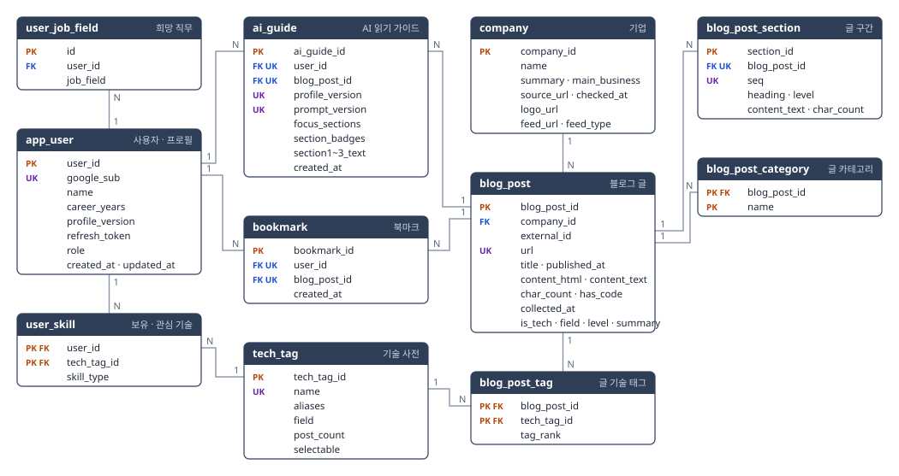

> **원본 사본.** 1차 미니프로젝트 8조 산출물(2026-09-29 제출본)을 고치지 않고 옮겼어요. MSA에서 지켜야 할 원본 동작을 확인할 때 봐요. MSA의 스펙 기준은 [design.md](../design.md)이고, 둘이 다르면 design.md를 따라요. 이 파일은 고치지 않아요.

# ERD · 테이블 명세서

LG CNS AM Inspire Camp 6기 · 미니 프로젝트 1 · 8조

| | |
|---|---|
| 작성일 | 2026-09-26 (9/29 수정) |
| 작성자 | 신해원 (팀장) |
| 문서 상태 | 제출본 · 2026-09-29 배포본 기준 |

> 표의 행 수는 9/22 로컬 적재 뒤 실제 DB 에서 센 값이다. 배포 DB 현황은 본문에 따로 적었다. 추정치는 쓰지 않았다.

---

## 1. 개요

| 항목 | 내용 |
|:---:|---|
| 대상 | 서비스가 쓰는 테이블 11개 |
| DB | MariaDB 12.3(배포 서버), 문자셋 utf8mb4 |
| 스키마 원천 | 서버 저장소의 JPA 엔티티. 서버를 켜면 엔티티에서 테이블이 만들어진다(`ddl-auto: update`). SQL 파일은 쓰지 않는다 |
| 관련 문서 | 수행계획서 4절(용어), 요구사항 명세서(FR 번호), API 명세서 |

테이블을 바꾸려면 엔티티와 이 문서를 같은 날 함께 고친다. 한쪽만 고치면 다시 어긋난다.

---

## 2. 설계 원칙

| 원칙 | 내용 |
|:---:|---|
| 기본 키 | 대리키 `BIGINT AUTO_INCREMENT`. `user_job_field.id` 만 INT. URL·이름 같은 자연키는 외래 키로 퍼뜨리지 않고 UNIQUE 로만 잡는다 |
| 다대다 | 교차 테이블로 푼다(`user_skill`, `blog_post_tag`). 복합 PK 를 쓰는 식별 관계 |
| 사용자와 글의 연결 | `ai_guide`, `bookmark` 는 개별 삭제·정렬·이력이 필요해 대리키에 복합 UNIQUE 를 건다 |
| 중복 적재 방지 | `blog_post.url` UNIQUE, 구간은 `(blog_post_id, seq)` UNIQUE. 같은 수집을 여러 번 돌려도 행이 늘지 않는다 |
| AI 가이드 재사용 | 프로필을 저장할 때마다 `profile_version` 이 1 오른다. 가이드는 이 번호로 찾으므로 프로필이 바뀌면 자동으로 새로 만든다 |
| 파생값 | 저장하지 않고 조회할 때 계산한다(기업별 글 수, 계열 분포). 예외는 글자 수 두 칸(`char_count`) |
| 이름 | 테이블과 컬럼은 소문자 스네이크 표기, 테이블은 단수형 |
| 시각 | `DATETIME`(한국 시간). 가입일·수정일만 `DATE` |
| 긴 본문 | `MEDIUMTEXT`. 실측 최대 56,200자라 `TEXT`(64KB)로는 잘린다 |
| 코드값 | `VARCHAR` 로 저장하고 서버에서 검사한다. `ENUM` 은 쓰지 않는다 |

---

## 3. ERD

PK 는 기본 키, FK 는 외래 키, UK 는 UNIQUE 제약에 속한 컬럼이다. 선 양 끝의 1 과 N 은 관계의 개수를 뜻한다.

---

## 4. 테이블 목록

| # | 테이블 | 이름 | 용도 | 관련 요구사항 | 행 수(9/22 로컬 적재) |
|:---:|:---:|:---:|---|:---:|:---:|
| 1 | `app_user` | 사용자 · 프로필 | 로그인 계정과 경력 년수, 프로필 버전 | FR‑01 FR‑02 FR‑08 | 사용 중 생성 |
| 2 | `user_job_field` | 희망 직무 | 사용자가 고른 계열 | FR‑02 FR‑08 | 사용 중 생성 |
| 3 | `user_skill` | 보유 · 관심 기술 | 사용자와 기술의 연결 | FR‑02 FR‑08 | 사용 중 생성 |
| 4 | `tech_tag` | 기술 사전 | 사용자와 글이 함께 참조하는 기술 이름 | FR‑02 FR‑03 | 541 |
| 5 | `company` | 기업 | 수집 대상 기업과 소개 | FR‑03 FR‑04 FR‑05 | 8 |
| 6 | `blog_post` | 블로그 글 | 수집한 글 원문과 AI 분류 결과 | FR‑03 FR‑05 | 402 |
| 7 | `blog_post_section` | 글 구간 | 본문을 소제목 단위로 나눈 조각 | FR‑03 FR‑06 | 4,753 |
| 8 | `blog_post_category` | 글 카테고리 | 블로그가 붙여 둔 분류어(적재 때 저장만 하고 조회 API 는 글 계열을 쓴다) | FR‑03 | 220 |
| 9 | `blog_post_tag` | 글 기술 태그 | 글마다 AI가 고른 핵심 기술 | FR‑03 FR‑04 FR‑05 | 899 |
| 10 | `ai_guide` | AI 읽기 가이드 | 사용자별로 만든 읽기 안내 | FR‑06 | 사용 중 생성 |
| 11 | `bookmark` | 북마크 | 저장한 글 | FR‑07 | 사용 중 생성 |

---

## 5. 테이블 정의

키 칸의 복합 제약은 같은 번호(①②③)로 묶었다.

### 5.1 app_user · 사용자 · 프로필

사용자 한 명에 프로필 하나라 프로필을 따로 떼지 않았다. 로그인은 Google 만 쓰므로 비밀번호 컬럼이 없다.

| 컬럼 | 타입 | NULL | 키 | 기본값 | 설명 |
|:---:|:---:|:---:|:---:|:---:|---|
| user_id | BIGINT | N | PK | 자동 증가 | 사용자 번호 |
| google_sub | VARCHAR(100) | N | UK |  | Google 계정 고유값. 이메일은 바뀔 수 있어 식별자로 쓰지 않는다 |
| name | VARCHAR(50) | N |  |  | Google 프로필 이름. 이메일과 사진은 저장하지 않는다 |
| career_years | INT | Y |  |  | 경력 년수. 0 은 신입, NULL 은 입력 전 |
| profile_version | INT | N |  | 0 | 최초 저장 시 1, 이후 저장할 때마다 1씩 오른다 |
| refresh_token | VARCHAR(255) | Y |  |  | 재발급용 토큰. 로그아웃하면 NULL |
| role | VARCHAR(255) | N |  | `USER` | `USER` 또는 `ADMIN`. 관리자 API 는 `ADMIN` 만 부른다 |
| created_at | DATE | N |  |  | 가입일 |
| updated_at | DATE | N |  |  | 마지막 프로필 수정일 |

### 5.2 user_job_field · 희망 직무

사용자 1 : N. 한 행이 희망 직무 하나다. 기업 상세의 글 목록을 계열로 거르는 입력값이다.

| 컬럼 | 타입 | NULL | 키 | 기본값 | 설명 |
|:---:|:---:|:---:|:---:|:---:|---|
| id | INT | N | PK | 자동 증가 |  |
| user_id | BIGINT | N | FK → app_user |  |  |
| job_field | VARCHAR(10) | N |  |  | `Backend` `Frontend` `Data` `Infra` `Mobile` 중 하나. 사용자당 1개 이상 |

### 5.3 user_skill · 보유 · 관심 기술

사용자와 기술의 다대다 교차 테이블. 한 행은 「이 사용자가 이 기술을 보유 또는 관심으로 골랐다」는 뜻이다.

| 컬럼 | 타입 | NULL | 키 | 기본값 | 설명 |
|:---:|:---:|:---:|:---:|:---:|---|
| user_id | BIGINT | N | PK①, FK → app_user |  |  |
| tech_tag_id | BIGINT | N | PK①, FK → tech_tag |  | 이름이 아니라 번호로 저장해야 글 태그와 정확히 맞는다 |
| skill_type | VARCHAR(10) | N |  |  | `HAVE`(보유) 또는 `WANT`(관심) |

PK 가 (사용자, 기술)이라 **같은 기술을 보유와 관심에 동시에 넣을 수 없다.** 프로필 저장은 그 사용자의 행을 모두 지우고 새로 넣는 방식이다. `user_job_field` 도 같다.

### 5.4 tech_tag · 기술 사전

사용자와 글이 같은 사전을 참조해야 「Kafka」가 양쪽에서 같은 번호로 만난다. 적재할 때만 넣고 화면에서 추가하지 않는다. 사전 가운데 사용자가 고를 수 있는 것은 20종이다(`selectable`).

| 컬럼 | 타입 | NULL | 키 | 기본값 | 설명 |
|:---:|:---:|:---:|:---:|:---:|---|
| tech_tag_id | BIGINT | N | PK | 자동 증가 |  |
| name | VARCHAR(50) | N | UK |  | 표준 표기. 예 `Kafka`, `Spring Boot` |
| aliases | VARCHAR(255) | Y |  |  | 다른 표기, 쉼표로 구분. 예 `kafka,카프카` |
| field | VARCHAR(30) | Y |  |  | 기술 계열. 입력 화면에서 칩을 묶는 기준 |
| post_count | INT | N |  | 0 | 쓰지 않는 컬럼. 칩에 글 수를 표시하지 않기로 해서 값이 모두 0 이다 |
| selectable | BOOLEAN | N |  | false | 사용자가 고를 수 있는 20종만 true |

### 5.5 company · 기업

글 수, 기간, 계열 분포, 많이 나온 기술은 저장하지 않고 조회할 때 집계한다.

| 컬럼 | 타입 | NULL | 키 | 기본값 | 설명 |
|:---:|:---:|:---:|:---:|:---:|---|
| company_id | BIGINT | N | PK | 자동 증가 |  |
| name | VARCHAR(100) | N |  |  | 기업 이름 |
| summary | VARCHAR(200) | Y |  |  | 한 줄 소개. 직접 작성 |
| main_business | VARCHAR(300) | Y |  |  | 주요 사업. 공식 소개에 적힌 것만 |
| source_url | VARCHAR(255) | Y |  |  | 기업 상세 화면의 출처 주소 |
| checked_at | DATETIME | Y |  |  | 출처를 확인한 날 |
| logo_url | VARCHAR(500) | Y |  |  | 공식 로고 이미지 주소. 없으면 화면이 로고 칸을 비운다 |
| feed_url | VARCHAR(255) | N |  |  | 피드, API, 사이트맵 주소 |
| feed_type | VARCHAR(20) | N |  |  | 수집 방식. `FEED_FULL` `FEED_PAGED` `FEED_LIST` `JSON_API` `SITEMAP` |

대상 기업은 기준으로 고른다. 본문 전문을 받을 수 있고, robots.txt 가 막지 않고, 최근 12개월 글이 20편 이상이면 행을 하나 추가한다.

### 5.6 blog_post · 블로그 글

글 하나가 한 행이다. 본문을 HTML 과 텍스트 두 벌로 저장한다. HTML 은 화면에 그대로 보여 주고, 텍스트는 AI 에 넣는다.

| 컬럼 | 타입 | NULL | 키 | 기본값 | 설명 |
|:---:|:---:|:---:|:---:|:---:|---|
| blog_post_id | BIGINT | N | PK | 자동 증가 |  |
| company_id | BIGINT | N | FK → company |  | 어느 기업의 글인지 |
| external_id | VARCHAR(255) | Y |  |  | 사이트가 준 글 고유값. 없는 사이트도 있다 |
| url | VARCHAR(500) | N | UK |  | 중복 적재를 막는 기준. 원문 링크에도 쓴다 |
| title | VARCHAR(300) | N |  |  |  |
| published_at | DATETIME | N |  |  | 발행 시각. 최신순 정렬 기준 |
| content_html | MEDIUMTEXT | N |  |  | 본문 원문 HTML |
| content_text | MEDIUMTEXT | N |  |  | 태그를 뗀 본문. AI 입력과 글자 수 계산에 쓴다 |
| char_count | INT | N |  |  | `content_text` 글자 수 |
| has_code | BOOLEAN | N |  |  | 본문에 코드 블록이 있는지 |
| collected_at | DATETIME | N |  |  | 수집 시각 |
| is_tech | BOOLEAN | Y |  |  | 기술 글이면 true. 채용, 행사, 공지는 false. 목록과 집계에서 false 인 글을 뺀다 |
| field | VARCHAR(10) | Y |  |  | 계열. `Backend` `Frontend` `Data` `Infra` `Mobile` `General` |
| level | VARCHAR(4) | Y |  |  | 난이도. `입문` `중급` `고급` |
| summary | VARCHAR(300) | Y |  |  | 한 줄 요지. 글 목록 카드에 보인다 |

`is_tech` `field` `level` `summary` 네 컬럼은 수집할 때 AI 가 채운다. AI 가 값을 채우지 못한 글도 있다. 배포 기술 글 310편 중 계열 없음 10편, 난이도 없음 8편, 요지 없음 8편이다.

### 5.7 blog_post_section · 글 구간

본문을 소제목(h2 · h3) 단위로 자른 읽기 단위. 목차와 AI 가이드의 구간 번호가 이 테이블의 `seq` 를 가리킨다.

| 컬럼 | 타입 | NULL | 키 | 기본값 | 설명 |
|:---:|:---:|:---:|:---:|:---:|---|
| section_id | BIGINT | N | PK | 자동 증가 |  |
| blog_post_id | BIGINT | N | FK → blog_post, UK① |  |  |
| seq | INT | N | UK① |  | 글 안에서의 순번. 1부터 빈 번호 없이 |
| heading | VARCHAR(300) | N |  |  | 구간 제목 |
| level | VARCHAR(4) | Y |  |  | `h2` 또는 `h3` |
| content_text | MEDIUMTEXT | N |  |  | 구간 본문 |
| char_count | INT | N |  |  | 구간 글자 수 |

한 글에 같은 소제목이 두 번 나오기도 해서 구간은 순번으로 구분한다. 소제목이 없는 기술 글 27편(배포 기준)은 구간이 없고, 읽기 가이드 대상에서 빠진다.

### 5.8 blog_post_category · 글 카테고리

블로그가 글에 붙여 둔 분류어를 원문 그대로 저장한다. 분류어를 붙이지 않는 블로그의 글은 행이 없다.

| 컬럼 | 타입 | NULL | 키 | 기본값 | 설명 |
|:---:|:---:|:---:|:---:|:---:|---|
| blog_post_id | BIGINT | N | PK①, FK → blog_post |  |  |
| name | VARCHAR(255) | N | PK① |  | 분류어 원문. 예 `Backend`, `Culture` |

### 5.9 blog_post_tag · 글 기술 태그

글과 기술의 다대다 교차 테이블. 수집할 때 AI 가 고른 핵심 기술 1~3개를 담는다. 본문에 나온 횟수를 세는 방식은 실측 정밀도가 8% 라 쓰지 않았다.

| 컬럼 | 타입 | NULL | 키 | 기본값 | 설명 |
|:---:|:---:|:---:|:---:|:---:|---|
| blog_post_id | BIGINT | N | PK①, FK → blog_post |  |  |
| tech_tag_id | BIGINT | N | PK①, FK → tech_tag |  |  |
| tag_rank | INT | Y |  |  | 핵심 순위. 1 이 가장 핵심. `rank` 는 MariaDB 예약어라 이름을 바꿨다 |

### 5.10 ai_guide · AI 읽기 가이드

AI 호출 결과 한 번이 한 행이다. **(사용자, 글, 프로필 버전, 지시문 버전)** 네 값이 모두 같으면 이 행을 다시 쓰고 AI 를 부르지 않는다.

| 컬럼 | 타입 | NULL | 키 | 기본값 | 설명 |
|:---:|:---:|:---:|:---:|:---:|---|
| ai_guide_id | BIGINT | N | PK | 자동 증가 |  |
| user_id | BIGINT | N | FK → app_user, UK② |  |  |
| blog_post_id | BIGINT | N | FK → blog_post, UK② |  |  |
| profile_version | INT | N | UK② |  | 만들 당시의 프로필 버전 |
| prompt_version | VARCHAR(20) | N | UK② |  | 만들 당시의 지시문 버전. 예 `v1`. API 응답에는 내보내지 않는다 |
| focus_sections | TEXT | Y |  |  | 먼저 읽을 구간 번호. JSON 배열. 예 `[2,3,6]` |
| section_badges | TEXT | Y |  |  | 구간별 등급. JSON 배열. 예 `[{"seq":1,"badge":"LIGHT"}]` |
| section1_text | TEXT | N |  |  | 이 글에서 볼 부분 |
| section2_text | TEXT | N |  |  | 내 수준에서 읽는 순서 |
| section3_text | TEXT | N |  |  | 이어서 공부할 것 |
| created_at | DATETIME | N |  |  | 만든 시각 |

구간 등급은 네 가지다. `KEY` 먼저 읽기, `LIGHT` 훑어보기, `REF` 참고, `SKIP` 건너뛰기. `section_badges` 는 구간 하나에 약 27자를 쓴다. 구간이 많은 글도 담을 수 있게 길이 제한이 없는 `TEXT` 로 둔다.

### 5.11 bookmark · 북마크

저장, 조회, 해제만 한다.

| 컬럼 | 타입 | NULL | 키 | 기본값 | 설명 |
|:---:|:---:|:---:|:---:|:---:|---|
| bookmark_id | BIGINT | N | PK | 자동 증가 | 개별 해제와 최근 저장 순 정렬 때문에 대리키를 둔다 |
| user_id | BIGINT | N | FK → app_user, UK③ |  |  |
| blog_post_id | BIGINT | N | FK → blog_post, UK③ |  | 같은 글을 두 번 저장할 수 없다 |
| created_at | DATETIME | N |  |  | 저장 시각. 최근 저장 순 정렬 기준 |

---

## 6. 관계와 제약

### 6.1 관계

| 부모 | 자식 | 관계 | 종류 | 뜻 |
|:---:|:---:|:---:|:---:|---|
| app_user | user_job_field | 1 : N | 비식별 | 희망 직무 |
| app_user | user_skill | 1 : N | 식별 | 보유 · 관심 기술 |
| tech_tag | user_skill | 1 : N | 식별 |  |
| company | blog_post | 1 : N | 비식별 | 기업의 글 |
| blog_post | blog_post_section | 1 : N | 비식별 | 소제목 단위 구간 |
| blog_post | blog_post_category | 1 : N | 식별 | 글의 분류어 |
| blog_post | blog_post_tag | 1 : N | 식별 | 글의 기술 태그 |
| tech_tag | blog_post_tag | 1 : N | 식별 |  |
| app_user | ai_guide | 1 : N | 비식별 | 사용자별 가이드 |
| blog_post | ai_guide | 1 : N | 비식별 |  |
| app_user | bookmark | 1 : N | 비식별 |  |
| blog_post | bookmark | 1 : N | 비식별 |  |

### 6.2 UNIQUE 제약

| 테이블 | 컬럼 | 막는 것 |
|:---:|:---:|---|
| app_user | google_sub | 같은 Google 계정으로 사용자가 두 번 만들어지는 것 |
| tech_tag | name | 같은 기술이 두 번 등록되는 것 |
| blog_post | url | 같은 글이 두 번 적재되는 것 |
| blog_post_section | (blog_post_id, seq) | 한 글에 같은 순번 구간이 두 개 생기는 것 |
| ai_guide | (user_id, blog_post_id, profile_version, prompt_version) | 같은 조건의 가이드가 두 번 저장되는 것 |
| bookmark | (user_id, blog_post_id) | 같은 글을 두 번 저장하는 것. 걸리면 API 가 409 `ALREADY_BOOKMARKED` |

### 6.3 삭제 정책

외래 키에 `ON DELETE` 를 지정하지 않았다. 자식 행이 있는 부모는 지울 수 없다. 서비스에 회원 탈퇴나 글 삭제 기능이 없어 동작에 문제가 없다.

### 6.4 인덱스

PK, UNIQUE, 외래 키에 자동으로 생기는 인덱스만 쓴다. 기술 글 310편 규모에서는 조회가 느려지지 않아 추가 인덱스를 두지 않았다.

---

## 7. 설계 결정

| 결정 | 이유 |
|:---:|---|
| 프로필을 사용자 테이블에 합침 | 사용자 한 명에 프로필이 하나뿐이다 |
| 희망 직무를 별도 테이블로 | 여러 개를 고를 수 있어 컬럼 하나로 담을 수 없다 |
| 기업 통계를 저장하지 않음 | 글이 추가될 때마다 다시 계산해야 하는 값이라 조회 시 집계한다 |
| 가이드 재사용 키에 지시문 버전 포함 | 지시문을 고치면 예전 가이드를 다시 쓰지 않는다 |
| 가입일을 DATE 로 둠 | 화면과 API 가 가입 시각을 쓰지 않는다 |
| 삭제 연쇄(CASCADE)를 두지 않음 | 부모를 지우는 기능이 없다 |

---

## 8. 변경 이력

| 날짜 | 내용 |
|:---:|---|
| 9/21 | 테이블 10개 설계. 채용 관련 테이블 3개 삭제 |
| 9/22 | 엔티티로 테이블 생성, 글 402편 적재 |
| 9/25 | 문서를 실제 DB 에 맞춰 정리. `user_job_field` 반영(엔티티는 9/22 #12 에서 11개로 생성), 쓰지 않는 컬럼 3개 삭제, `company.logo_url` 추가 |
| 9/26 | `ai_guide.focus_sections` · `section_badges` 를 TEXT 로 변경. 구간이 10개를 넘는 글의 가이드가 저장되지 않던 문제 |
